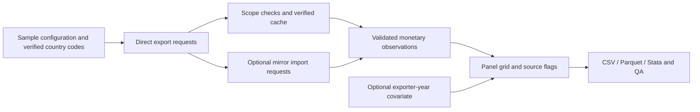

# UN Comtrade Research Pipeline

A Python workflow for collecting bilateral merchandise-trade records and constructing exporter–importer–product–year panels.

**Author: Xiangyu Zheng.** This repository presents a general version of my trade-data collection and processing workflow. It demonstrates country-code handling, resumable API collection, data validation, mirror-trade direction conversion, and panel construction. The public examples use **invented values**. Research datasets, unpublished findings, and manuscript files are excluded.

## Start here

Run a small example without an account, API key, or network connection:

```sh
python -m venv .venv
source .venv/bin/activate
python -m pip install -r requirements.txt
python -m comtrade_pipeline demo
```

The example creates a 12-row panel in `outputs/demo/`: two direct observations, one mirror observation, and nine unresolved cells. One direct observation is an explicitly reported zero. These numbers describe the invented example only.

For reviewers, the main transformations are in [panel.py](comtrade_pipeline/panel.py), request handling is in [api.py](comtrade_pipeline/api.py), and execution steps are in [__main__.py](comtrade_pipeline/__main__.py). The [methodology note](docs/methodology.md) explains the assumptions behind each field.

## What the workflow does

1. Read explicit Comtrade country mappings and a configurable product/year sample.
2. Collect direct exports, split requests that reach the response cap, and verify cached responses before reusing them.
3. Optionally collect partner-reported imports for exporter-years without direct coverage, then reverse the reporter/partner direction.
4. Construct a consistent panel grid, preserve observation provenance, optionally merge an exporter-year covariate, and write quality summaries.



## Build a panel offline

The `build` command accepts normalized observation CSVs. These examples are supplied in the repository:

```sh
python -m comtrade_pipeline build \
  --config config/example.json \
  --direct examples/direct_synthetic.csv \
  --mirror examples/mirror_synthetic.csv \
  --coverage examples/coverage_synthetic.csv \
  --cyber examples/cyber_synthetic.csv \
  --output outputs/offline-build
```

Use a fresh output folder for each offline build. `--cyber` is optional; its three columns are `exporter_iso3`, `year`, and `cyber`. Example covariate scores are invented and have no empirical interpretation. Raw API-shaped DataFrames can be converted using `standardize()` in `panel.py`.

## Collect fresh records

The `collect` command accesses the official UN Comtrade API with your own subscription key. The sample configuration contains three countries, two products, and one illustrative year. It is not a paper's estimation sample.

Set the environment variable `UN_COMTRADE_API_KEY` in your shell, then run:

```sh
python -m comtrade_pipeline collect \
  --config config/example.json \
  --output outputs/fresh-collection \
  --mirror
```

The key is sent in an HTTP header and is excluded from saved metadata. `.env.example` documents the variable; the program does not automatically load `.env` files. Use your shell's secure input mechanism rather than committing credentials or embedding them in code.

The default response cap is 500 records. Set `--max-records` only to a limit supported by your subscription. Adapt `--interval` to your request quota. A response at the configured cap is split by product; an unsplittable response at the cap stops processing. No preview endpoint is used for full collection. [Official API documentation](https://uncomtrade.org/docs/un-comtrade-api/) describes subscription access.

Request CSVs and metadata are stored under the chosen output directory. Repeat the same collection command to reuse verified successful requests. Failed requests never establish coverage. Parent requests that required splitting can be repeated on resume before their cached child requests are reused. Data are a cached snapshot; use a new output folder to refresh them. Changing inputs or key output options requires a new output folder.

Country mappings are explicit inputs. Verify them against Comtrade's reference/availability information for your period; ordinary ISO numeric codes do not always equal Comtrade reporting-area codes. The software does not guess a country code or select between historical codes automatically.

## Missing values and product definitions

**Absent records remain missing by default.** Country-year reporting availability alone does not prove that every unreturned product/partner cell is a true zero. The optional `--zero-policy legacy-coverage` reproduces a coverage-based assumption only when the relevant collection completed; it is not a recommended substitute for product-validity and confidentiality checks.

`classification="HS"` requests original reported classifications. It does not harmonize product definitions across HS revisions. Returned classification identifiers are preserved, and conflicting values/classifications at one panel key stop processing. A common six-digit string is not proof of comparable product content across editions. [UN Comtrade's conversion note](https://uncomtrade.org/docs/data-conversion/) explains the limitations of classification conversion.

Mirrors enter only wholly uncovered exporter-years; they do not replace direct values or fill individual holes within directly covered exporter-years. Partner-reported imports may differ from directly reported exports in valuation, timing, and coverage. Source flags allow users to distinguish them; this repository does not estimate research effects or claim that mirrors eliminate missing data.

## Outputs and checks

The panel key is `year`, `exporter_iso3`, `importer_iso3`, `hs6`. `panel_id` is stable across years for an unchanged sample grid. CSV and JSON quality summaries are written by default. For Parquet, install `requirements-optional.txt`; Stata export uses pandas:

```sh
python -m pip install -r requirements-optional.txt
python -m comtrade_pipeline demo --output outputs/demo-formats --formats csv parquet stata
python -m unittest discover -s tests -v
```

Tests cover mirror direction, direct-source priority, repeated/conflicting records, units, invalid values, zero assumptions, API failures, response limits, and cache integrity. See [validation.md](docs/validation.md) for what was actually verified. A GitHub Actions workflow runs offline tests after upload; no hosted run is claimed here.

## Repository contents

| Path | Purpose |
| --- | --- |
| `comtrade_pipeline/` | Collection, transformations, and command-line entry points |
| `config/` | Small illustrative configuration and explicit country mappings |
| `examples/` | Invented observations, coverage flags, covariate, and expected panel |
| `tests/` | Offline regression checks with synthetic responses |
| `docs/` | Methodology, data dictionary, and validation scope |
| `reports/` | Validation summary for this public software version |

This is a portfolio refactor from a research workflow that evolved through collection, country-code correction, and mirror completion. It is not a replication package for a published article. The public package includes no empirical research dataset, sample-specific results, API credentials, or manuscript text. A software reuse license has not yet been selected. UN Comtrade and other third-party materials retain their own terms; see [references.md](docs/references.md).
